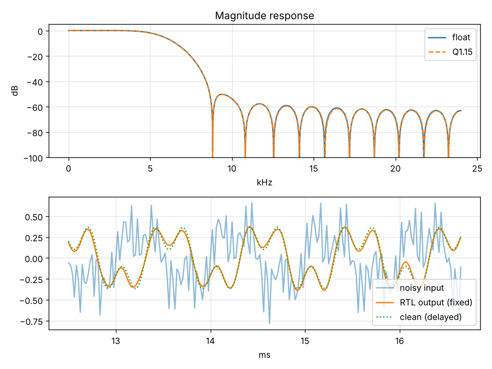

# Pipelined Fixed-Point FIR Filter (Verilog)

A 31-tap linear-phase low-pass FIR filter in three RTL versions, from a
straightforward baseline to an area-, timing- and power-optimised design.
All three are verified bit-exact against a Python golden model, and
characterised in Vivado (post-route, activity-annotated power).

| Version | Idea | Fmax | Dynamic power @ 100 MHz |
|---|---|---|---|
| `fir_direct` | baseline: 31 multipliers, one adder tree | 23.9 MHz | 130 mW |
| `fir_folded` | symmetric folding + zero-tap pruning: 13 multipliers | 40.1 MHz | 73 mW (−44%) |
| `fir_pipe` | folded + 5-stage pipeline | **130.4 MHz (5.5×)** | **36 mW (−72%)** |

Kintex-7 `xc7k70tfbv676-1`, Vivado post-route, out-of-context, power from
SAIF switching activity (confidence: High). Every routed netlist passed the
same bit-exact testbench. Full numbers: [`results/vivado_summary.csv`](results/vivado_summary.csv).

---

## Filter design

* Low-pass, fs = 48 kHz, cutoff 6 kHz, Hamming window (`scipy.signal.firwin`), 31 taps
* Q1.15 fixed point for samples and coefficients, 32-bit accumulator, round-half-up, saturate to int16
* Test signal: 1 kHz + 3 kHz wanted tones, 14 kHz + 19 kHz interferers, white noise

| Metric | Value |
|---|---|
| SNR in → out | 2.8 dB → 20.7 dB |
| Quantisation SNR (fixed vs float output) | 87 dB |
| Stop-band attenuation (≥ 9 kHz) | 50 dB (float and Q1.15) |



## Architecture

**`fir_direct`** is the textbook form: a 31-sample delay line, one constant
multiplier per tap, and one combinational adder tree into the output register.

**`fir_folded`** uses the linear-phase symmetry c[k] = c[30−k]:

```
y = Σ_{k<15} c[k]·(x[n−k] + x[n−30+k])  +  c[15]·x[n−15]
```

A 17-bit pre-adder per tap pair halves the multipliers (31 → 16). Six
coefficients are exactly zero (the window-sinc zero crossings at fs/8), so
those pairs generate no hardware at all, leaving **13 multipliers**. Integer
arithmetic is exact, so the output is bit-identical to the baseline.

**`fir_pipe`** splits the folded datapath into five stages:

```
S0 delay line → S1 pre-add → S2 multiply → S3 four partial sums → S4 final add + round + saturate
```

Each stage register loads only when its valid tag is set. Pipelining raises
Fmax and also **lowers** power, even though it adds registers: short
combinational paths stop glitches from rippling through the long adder chain.

All versions take one sample per clock with a `valid` handshake and tolerate
gaps in the input stream. Latency is 2 cycles (direct, folded) and 5 cycles (pipe).

## Verification

`tb/tb_fir.v` is a self-checking testbench shared by all three versions. It
compares every output sample with the Python golden model:

* the filtered test signal (4,096 samples)
* an impulse, whose response must equal the coefficients
* a negative full-scale step, which exercises saturation and rounding
* 2,048 full-scale random samples
* each of the above with continuous input and with random `in_valid` gaps

Results: **6,272 / 6,272 samples bit-exact** for every version, in RTL
simulation (Icarus Verilog) and in post-route netlist simulation (Vivado
xsim). All RTL is lint-clean under `verilator --lint-only -Wall`.

## Repository layout

```
model/fir_model.py   filter design, Q1.15 golden model, test vectors, metrics, plot
rtl/fir_direct.v     baseline
rtl/fir_folded.v     symmetric folding + zero-tap pruning
rtl/fir_pipe.v       folded + 5-stage pipeline
rtl/fir_coeffs.vh    generated coefficients (shared by all versions)
tb/tb_fir.v          self-checking testbench
sim/                 generated stimulus and golden output
vivado/run_ppa.tcl   synth + place + route, Fmax, netlist sim + SAIF, power
results/             DSP metrics, frequency response plot, Vivado summary
run_sim.sh           regenerate vectors and run all functional checks
```

## Running

```bash
pip install -r requirements.txt
./run_sim.sh                       # functional check with Icarus Verilog
```

Vivado (from the Vivado Tcl Shell, or the Tcl Console with no project open):

```tcl
cd fir_filter/vivado
source run_ppa.tcl                 # set PART at the top of the script first
```

The script writes `vivado/out/summary.csv` and full utilisation, timing and
power reports for each version.

## Notes

* The 100 MHz power comparison is at an equal clock. Only `fir_pipe` closes
  timing there, so the direct and folded figures show what those designs
  would draw if they ran at that rate. Dynamic power scales with frequency,
  so the relative savings hold.
* Static power (≈ 80 mW) is FPGA leakage and nearly constant across designs,
  so only dynamic power is compared.
* Fmax is measured against an aggressive 3 ns target: Fmax = 1000 / (3 − WNS).
